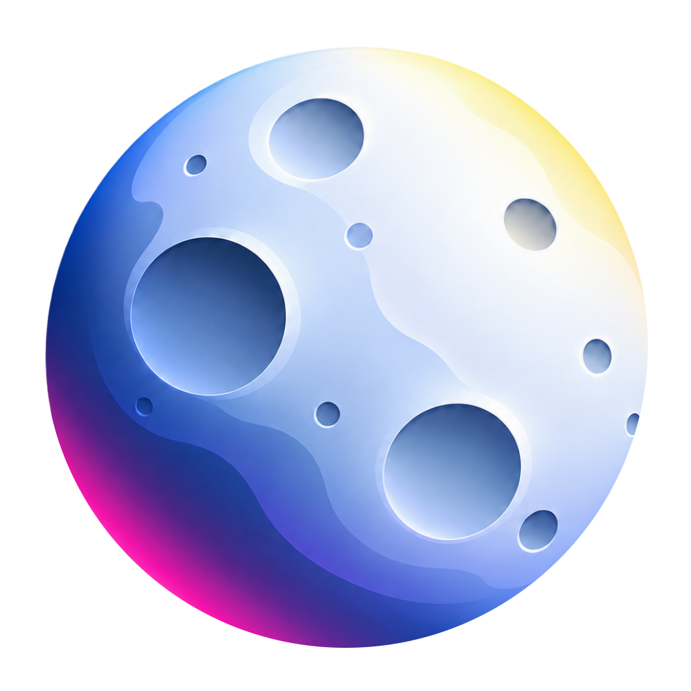
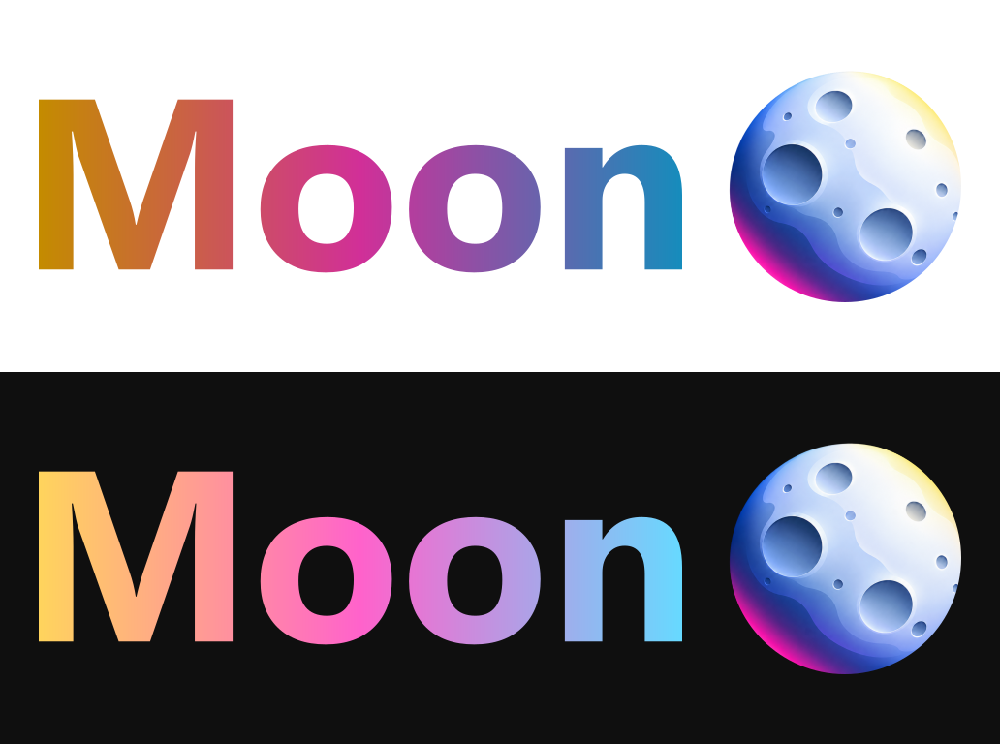

<p align="center"></p>

# Moon Patches

Watch YouTube together with **Nya Rooms**, and give it a Moon identity. An independent fork of [Morphe Patches](https://github.com/MorpheApp/morphe-patches), with native Android controls and encrypted coordination over public Nostr relays. You do not need to host a server.

**[Add to Morphe](https://morphe.software/add-source?github=noire342/moon-patches&name=Moon%20Patches)** · **[Download the bundle](https://github.com/noire342/moon-patches/releases/latest)** · **[Guida italiana](docs/installation-it.md)**

## Install

In Morphe, open **Sources → + → Remote** and paste:

```text
https://github.com/noire342/moon-patches
```

Choose **Moon Patches** as the source for YouTube. This bundle already contains the base patches; combining the equivalent official patches with it can cause conflicts. Select **Nya Rooms**, **Custom branding** and **Change header**, alongside the usual recommended patches. Obtain the original YouTube APK yourself. No YouTube APK is distributed here.

After patching, choose **Moon** in the app icon and header settings. Set the launcher name to **Moon** through Custom branding. For a fixed name during patching, set `customName` to `Moon`. In the app, the rooms button is beside Search and is also available in the player.

## What is included

- Create or join a room from Home without opening a video first.
- Eight-digit invitations, with explicit host approval and a key fingerprint.
- Everyone can play, pause and seek by default. The host can restrict controls.
- Native player actions synchronize too; commands are bound to the current video.
- Lobby, connection status, participants, optional wait-for-everyone and host closure.
- SponsorBlock is suspended while creating, joining, reconnecting or participating in a room.
- A native, theme-aware room sheet with paste/share actions, keyboard handling and accessible touch targets.
- Moon launcher, monochrome/notification icons, startup graphic and a yellow → fuchsia → sky-blue header wordmark.
- An offline Moon About logo, project links, version information and preserved upstream credits/license notices.
- The existing base patch catalogue. See [patches-list.json](patches-list.json).



## Compatibility and status

The rooms integration is experimental. The release notes and [validation record](docs/validation.md) name the exact tested versions. Regular YouTube videos are supported; Shorts, live streams and casting are outside the rooms support scope. Sessions have a maximum of eight participants and six hours. There is no chat, playlist synchronization, host transfer or Nyanime interoperability yet.

Public relay availability can change. Nostr transports control messages, not the video: each participant streams from YouTube independently and may experience different buffering. The UI currently uses Italian room text.

## Documentation

| Document | Contents |
| --- | --- |
| [Italian installation guide](docs/installation-it.md) | Morphe source, branding, room controls and troubleshooting |
| [Privacy](PRIVACY.md) | What peers and relays can see, and what is retained |
| [Protocol](docs/rooms/protocol.md) | Authentication, admission, encryption and synchronization |
| [Build](docs/build.md) | Toolchain, pinned base sources, tests and bundle generation |
| [Licensing and credits](THIRD_PARTY_NOTICES.md) | GPLv3, upstream notices and dependency licenses |
| [Validation](docs/validation.md) | Verified behavior and remaining device coverage |
| [Changelog](CHANGELOG.md) | Moon changes |
| [Contributing](CONTRIBUTING.md) / [Security](SECURITY.md) | Bug reports and security reporting |

## License and origin

Code and new Moon assets are distributed under **GPL-3.0-only**, with the preserved Morphe Section 7 notices. Read [LICENSE](LICENSE), [NOTICE](NOTICE) and [THIRD_PARTY_NOTICES.md](THIRD_PARTY_NOTICES.md). Third-party components retain their own licenses.

This is an independent modified project, maintained by Moon Patches contributors. It is not an official Morphe or YouTube release. Morphe, YouTube and other product names belong to their respective holders. Original Morphe branding has been replaced; compatible code namespaces and launcher aliases remain.
